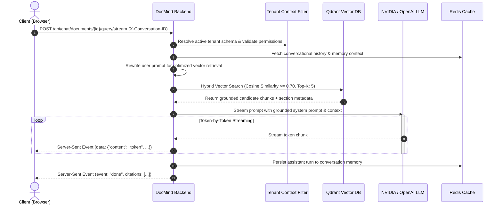
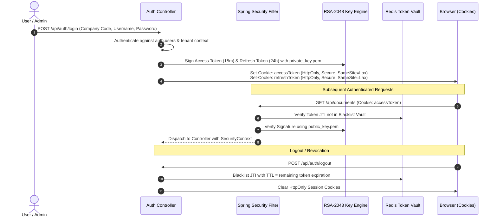
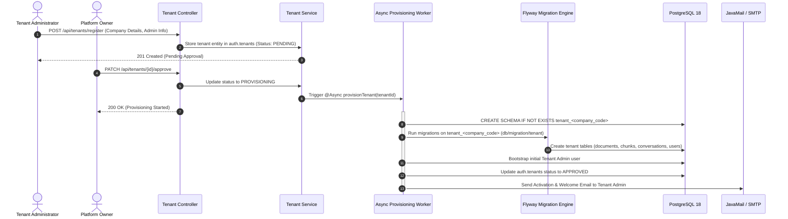
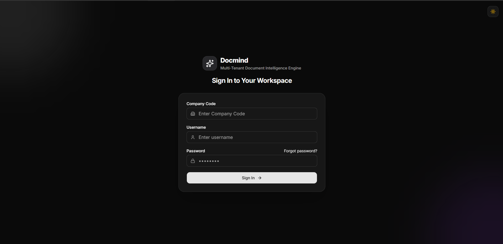
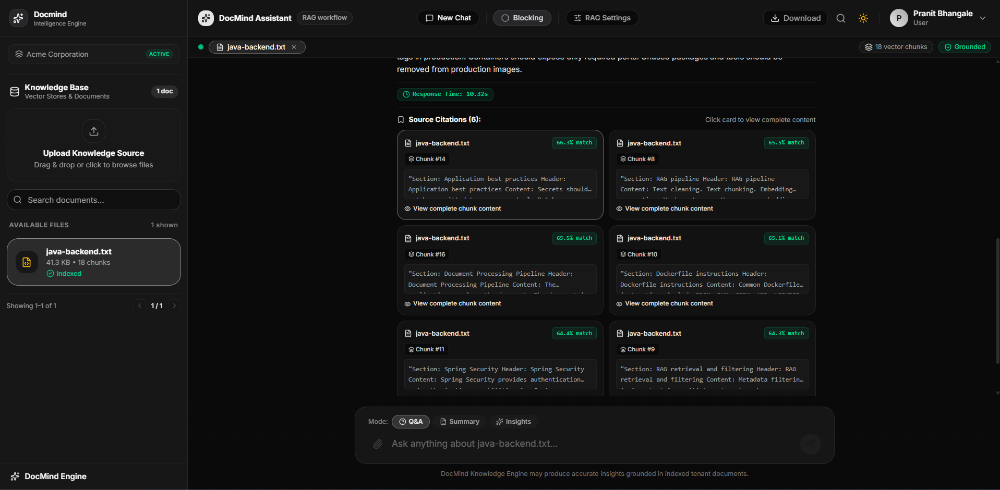

# DocMind Intelligence Engine


> **Enterprise-Grade Multi-Tenant Document Intelligence, Semantic Chunk Enrichment & Hybrid RAG Engine.**  
> Ingest unstructured knowledge, maintain strict PostgreSQL schema isolation per organization, and stream grounded AI
> responses with token-level transparency.

[](https://openjdk.org/)
[](https://spring.io/projects/spring-boot)
[](https://spring.io/projects/spring-ai)
[](https://www.postgresql.org/)
[](https://qdrant.tech/)
[](https://redis.io/)
[](https://react.dev/)
[](https://tailwindcss.com/)
[](https://www.docker.com/)
---

## Table of Contents

- [1. Executive Overview](#1-executive-overview)
- [2. System Architecture](#2-system-architecture)
    - [High-Level Topology](#high-level-topology)
    - [Real-Time Streaming RAG Pipeline](#real-time-streaming-rag-pipeline)
    - [RS256 JWT Authentication & Revocation Lifecycle](#rs256-jwt-authentication--revocation-lifecycle)
- [3. Key Platform Features](#3-key-platform-features)
- [4. Multi-Tenancy Architecture Deep Dive](#4-multi-tenancy-architecture-deep-dive)
    - [Schema-per-Tenant Isolation Model](#schema-per-tenant-isolation-model)
    - [Search Path & Dynamic Connection Resolution](#search-path--dynamic-connection-resolution)
    - [Automated Tenant Provisioning Flow](#automated-tenant-provisioning-flow)
    - [Context Propagation Across Concurrency](#context-propagation-across-concurrency)
    - [Three-Tier Role-Based Access Control](#three-tier-role-based-access-control)
- [5. Visual Platform Tour](#5-visual-platform-tour)
- [6. Document Enrichment Engine](#6-document-enrichment-engine)
- [7. Technology Stack Matrix](#7-technology-stack-matrix)
- [8. Production Deployment Engine (deploy.sh)](#8-production-deployment-engine-deploysh)
    - [Internal Architecture & Mechanics](#internal-architecture--mechanics)
    - [Lifecycle Command Reference](#lifecycle-command-reference)
    - [Global Options & CLI Flags](#global-options--cli-flags)
    - [Incremental Build Change Detection](#incremental-build-change-detection)
- [9. Docker Compose Infrastructure & Port Map](#9-docker-compose-infrastructure--port-map)
- [10. REST API Specification & cURL Examples](#10-rest-api-specification--curl-examples)
- [11. Getting Started & Local Development](#11-getting-started--local-development)
    - [Prerequisites](#prerequisites)
    - [Step 1: Environment File Configuration](#step-1-environment-file-configuration)
    - [Step 2: RSA Keypair & Secret Generation](#step-2-rsa-keypair--secret-generation)
    - [Step 3: Launching via Docker Controller](#step-3-launching-via-docker-controller)
    - [Step 4: Manual Native Development](#step-4-manual-native-development)
- [12. Operational FAQs & Troubleshooting](#12-operational-faqs--troubleshooting)

---

## 1. Executive Overview

**DocMind Intelligence Engine** is an enterprise-ready, multi-tenant document analysis, synthesis, and conversational
question-answering platform built as a high-performance modular monolith.

Modern enterprises face dual challenges when deploying AI on proprietary data:

1. **Data Leakage & Multi-Tenant Isolation**: Ensuring strict regulatory compliance where one tenant's documents or
   vector embeddings are physically and logically segregated from others.
2. **Context Quality & Retrieval Latency**: Eliminating hallucinations by enriching document chunks with structural
   semantics and streaming grounded answers with exact source citations.

DocMind solves both challenges at scale:

- **Logical & Physical Data Privacy**: Implements **PostgreSQL Schema-per-Tenant** isolation (`tenant_<company_code>`)
  managed dynamically by Flyway, paired with isolated metadata filters in **Qdrant Vector DB**.
- **LLM-Powered Chunk Enrichment**: Employs an asynchronous, virtual-thread-backed enrichment subsystem that extracts
  structural section titles and summaries prior to vectorization.
- **Low-Latency Streaming**: Utilizes Spring WebFlux Server-Sent Events (SSE) to stream generated tokens in real time
  directly to a reactive **React 19** frontend.

---

## 2. System Architecture

### High-Level Topology

```text
                                  +---------------------------------------+
                                  |           React 19 Frontend           |
                                  |   (Vite 8 + Tailwind v4 + Radix UI)   |
                                  +-------------------+-------------------+
                                                      |
                                                      | HTTP / Server-Sent Events (SSE)
                                                      v
                                  +---------------------------------------+
                                  |          docmind-nginx Gateway        |
                                  |        (Reverse Proxy & SSL Term)     |
                                  +-------------------+-------------------+
                                                      |
                                                      v
                                  +---------------------------------------+
                                  |       DocMind Spring Boot 4.1.1       |
                                  |    (Java 25 + Virtual Threads + JPA)  |
                                  +---+---------------+---------------+---+
                                      |               |               |
             +------------------------+               |               +------------------------+
             | Dynamic Schema Routing                 | Vector Store                           | Tokens & Blacklist
             v (SET search_path)                      v (gRPC / REST)                          v (Jedis / Lettuce)
   +-------------------+                    +-------------------+                    +-------------------+
   |   PostgreSQL 18   |                    |   Qdrant Vector   |                    |      Redis 8      |
   | (Relational Store)|                    |  (Embeddings DB)  |                    |  (Session Cache)  |
   +-------------------+                    +-------------------+                    +-------------------+
     ├── auth (Shared Platform)                       |
     ├── tenant_acme (Tenant A)                       v
     └── tenant_globex (Tenant B)           +-------------------+
                                            | LLM Provider APIs |
                                            | (NVIDIA / OpenAI) |
                                            +-------------------+
```

---

### Real-Time Streaming RAG Pipeline



---

### RS256 JWT Authentication & Revocation Lifecycle



---

## 3. Key Platform Features

- **Dynamic Schema Multi-Tenancy**: Zero-data-bleed architecture separating organizations into individual PostgreSQL
  schemas with shared platform user registries.
- **Universal Document Ingestion**: Ingests and parses complex PDF, DOCX, Markdown, and TXT files using Apache Tika and
  Spring AI PDF readers.
- **High-Speed Vector Similarity Search**: Qdrant Vector Store Advisor integration utilizing cosine distance, similarity
  cutoffs (`0.70`), and candidate filtering (`candidate-k: 20`).
- **Low-Latency Server-Sent Events (SSE)**: Real-time, reactive token streaming delivering prompt feedback directly into
  the UI with zero buffering.
- **Smart Metadata Enrichment (`DocumentEnricher`)**: Automatically enriches text chunks with LLM-generated section
  headings and semantic summaries before indexing.
- **Provider-Agnostic LLM Strategy**: Dynamic model switching supporting NVIDIA NIM (`nemotron-3.5-lightning`), OpenAI
  (`gpt-4o`, `gpt-oss`), and Ollama (`qwen3.5`).
- **Asymmetric RS256 Security**: Military-grade JWT security utilizing 2048-bit RSA keys, eliminating shared secret
  vulnerabilities.
- **XSS-Resistant Cookie Delivery**: Tokens are transmitted exclusively through `HttpOnly`, `SameSite=Lax` cookies,
  protecting against JavaScript token scraping.
- **Enterprise OTP Account Recovery**: Self-service forgot-password workflow with time-limited OTP delivery, Redis token
  vaults, and tenant resolution.
- **Granular RBAC**: Three-tier permission model supporting Platform Owners, Tenant Administrators, and Tenant Users.
- **Modern React 19 Frontend**: Dark/light themed user experience constructed with React 19, Tailwind CSS v4, Radix UI
  primitives, Lucide icons, and interactive citations.
- **One-Command Docker Deployment**: Production Docker Compose configuration orchestrating backend, frontend, databases,
  caches, and reverse proxies.
- **Production CLI Controller (`deploy.sh`)**: 1800+ line deployment engine with incremental change-detection builds,
  automated health checks, and registry tagging.

---

## 4. Multi-Tenancy Architecture Deep Dive

DocMind uses a **Schema-per-Tenant** isolation model in PostgreSQL. This architecture guarantees strict logical and
physical data isolation for enterprise tenants while maintaining high infrastructure efficiency.

### Schema-per-Tenant Isolation Model

```text
PostgreSQL 18 Database ("docmind")
 │
 ├── 📂 Schema: "auth" (Shared Platform Metadata)
 │    ├── 📄 tenants             (Company codes, lifecycle statuses, admin details)
 │    ├── 📄 users               (Global user identifiers, credentials, tenant links)
 │    ├── 📄 roles               (ROLE_OWNER, ROLE_ADMIN, ROLE_USER)
 │    ├── 📄 permissions         (Fine-grained security authorities)
 │    ├── 📄 user_roles          (Role assignments per user)
 │    ├── 📄 role_permissions   (Permission mappings per role)
 │    └── 📄 refresh_tokens      (Hashed persistent session tokens)
 │
 ├── 📂 Schema: "tenant_acme" (Tenant: Acme Corporation)
 │    ├── 📄 users               (Tenant-specific user profile overrides)
 │    ├── 📄 user_roles          (Tenant-level role assignments)
 │    ├── 📄 documents           (Metadata, MIME types, processing status)
 │    ├── 📄 document_chunks     (Text slices, token counts, enrichments)
 │    ├── 📄 conversations       (Chat threads and session contexts)
 │    └── 📄 conversation_messages (Turns, queries, assistant responses)
 │
 └── 📂 Schema: "tenant_globex" (Tenant: Globex International)
      ├── 📄 users
      ├── 📄 documents
      └── ...
```

---

### Search Path & Dynamic Connection Resolution

When a request arrives, DocMind resolves the active tenant through JWT claims or the request context. Hibernate's
`MultiTenantConnectionProviderImpl` dynamically adjusts PostgreSQL's `search_path`:

```sql
-- Dynamically applied by MultiTenantConnectionProviderImpl upon acquiring connection:
SET
search_path TO tenant_acme, auth;
```

> [!NOTE]
> By configuring `search_path TO tenant_<name>, auth`, tenant-specific tables (such as `documents` and `conversations`)
resolve to the tenant's isolated schema, while platform entities (such as `tenants` and `roles`) resolve to the shared
`auth` schema seamlessly without explicit schema qualifications in SQL.

---

### Automated Tenant Provisioning Flow



---

### Context Propagation Across Concurrency

In standard Spring applications, `ThreadLocal` contexts are lost when dispatching to child threads or reactive streaming
pipelines. DocMind solves this using two explicit bridges:

1. **Virtual Threads Async Propagation (`TenantAsyncConfig`)**:  
   Registers a `TaskDecorator` that copies the `TenantContext` from the initiating thread to Java 25 virtual threads
   during asynchronous document parsing and enrichment.
2. **Reactive WebFlux SSE Propagation (`ReactorContextPropagationConfig`)**:  
   Integrates **Micrometer Context Propagation** with Project Reactor:
   Registers a `TenantContextAccessor` with `ContextRegistry` and invokes `Hooks.enableAutomaticContextPropagation()`.  
   This ensures that during long-lived Server-Sent Event (SSE) query streaming, the tenant's connection search path
   remains locked to the correct organization on every emitted token.

---

### Three-Tier Role-Based Access Control

<!--suppress MarkdownIncorrectTableFormatting -->

| Role             | Scope               | Key Capabilities                                                                                |
|:-----------------|:--------------------|:------------------------------------------------------------------------------------------------|
| **`ROLE_OWNER`** | Platform-Wide       | Access Platform Dashboard; approve/reject tenant registrations; monitor global platform health. |
| **`ROLE_ADMIN`** | Tenant Organization | Onboard and deactivate employee accounts; configure tenant parameters; manage tenant documents. |
| **`ROLE_USER`**  | Tenant Workspace    | Upload and delete documents; execute RAG queries; stream AI responses; inspect citations.       |

---

## 5. Visual Platform Tour

### Landing Page & Entry Gateway

The front door to the platform, presenting system capabilities, high-level architecture, and direct navigation into user
workspaces.


---

### Organization-Aware Authentication

Sign-in modal featuring dynamic **Company Code** routing. Leaving company code blank authenticates Platform
Administrators directly against the primary platform domain.



---

### Self-Service Tenant Onboarding

Interactive onboarding workflow capturing legal company name, custom slug identifier (used for the database schema), and
initial administrator credentials.


---

### Platform Owner Dashboard & Approval Pipeline

Comprehensive operational command center for the Platform Owner to review onboarding applications, inspect company
codes, and trigger schema provisioning.


---

### Tenant User Management

Tenant administrators can invite team members, assign role authorities, and manage user statuses within their dedicated
organization partition.


---

### Document Intelligence Workspace

Central workspace interface displaying active tenant documents, ingestion timestamps, chunk statistics, and upload
facilities.


---

### Conversational Streaming RAG

Conversational AI interface streaming responses in real time with model selection, reasoning transparency, and query
rewriting.


---

### Grounded Citations & Confidence Inspector

Verify the model's factual foundation. Clicking any citation opens the exact document chunk excerpt, similarity score,
and source page number.



---

## 6. Document Enrichment Engine

Standard naive RAG models frequently fail when document chunks lack structural context (e.g., a table or paragraph
without its parent section title). DocMind features a dedicated **`DocumentEnricher`** that uses an LLM to inject
semantic context before embeddings are computed.

```text
  Raw Unstructured Chunk
            │
            ▼
┌─────────────────────────┐
│ Chunk Character Budget? │ ──(Exceeds Limit)──► Use Raw Chunk
└───────────┬─────────────┘
            │ (Within Limit)
            ▼
┌─────────────────────────┐
│ Concurrency Semaphore   │ ──(Max 8 Concurrent Tasks)
└───────────┬─────────────┘
            │
            ▼
┌─────────────────────────┐
│ LLM Metadata Enricher   │ ──► Generates: Section Header, Summary, Semantic Tags
└───────────┬─────────────┘
            │
     (API Exception?)
       ├── YES ──► Circuit Breaker Records Failure ──► Return Raw Chunk (Zero Downtime)
       └── NO  ──► Prepend Header & Summary to Text ──► Submit to Qdrant Vector Store
```

### Architectural Resilience Parameters (`application.yaml`)

```yaml
docmind:
  enrich:
    enabled: true
    chunks-per-request: 5         # Batch size dispatched to enrichment LLM
    max-attempts: 3               # Exponential retry attempts on transient network error
    max-content-chars: 800        # Maximum chunk size sent to enrichment model
    call-timeout-seconds: 30      # Per-request timeout limit
    max-concurrency: 8           # Guarded by Java 25 Virtual Thread semaphores
    requests-per-second: 10       # Token bucket rate-limiter
    breaker-failure-threshold: 5  # Trips circuit breaker after 5 consecutive failures
    breaker-open-seconds: 30      # Circuit remains open for 30s before half-open probe
```

> [!TIP]
> **Fault-Tolerant Guarantee**: If the enrichment provider experiences downtime or rate limits, the system trips its
circuit breaker and transparently indexes raw document chunks. Document uploads never fail due to enrichment
unavailability.

---

## 7. Technology Stack Matrix

<!--suppress MarkdownIncorrectTableFormatting -->

| Domain            | Technology / Library           | Version       | Role in DocMind                                               |
|:------------------|:-------------------------------|:--------------|:--------------------------------------------------------------|
| **Language**      | Java (OpenJDK)                 | **25**        | Core backend engine utilizing Project Loom Virtual Threads    |
| **Framework**     | Spring Boot                    | **4.1.1**     | Modular monolith framework, dependency injection & REST APIs  |
| **AI Framework**  | Spring AI                      | **2.0.0**     | Vector store abstraction, model clients, chat memory advisors |
| **Relational DB** | PostgreSQL                     | **18-alpine** | Relational data persistence with schema multi-tenancy         |
| **Vector DB**     | Qdrant                         | **Latest**    | High-performance vector similarity search (REST & gRPC)       |
| **Cache & Store** | Redis                          | **8-alpine**  | Refresh token persistence, JWT revocation list, OTP vault     |
| **Migrations**    | Flyway Core                    | **Latest**    | Common schema initialization & dynamic tenant schema runner   |
| **Parsers**       | Apache Tika & Spring AI Reader | **Latest**    | High-fidelity text extraction from PDFs, DOCX, Markdown, TXT  |
| **Security**      | Spring Security & JJWT         | **0.12.6**    | RS256 RSA asymmetric cryptography & RBAC filters              |
| **Frontend**      | React & TypeScript             | **19 & 5**    | Reactive single-page application dashboard                    |
| **Bundler**       | Vite                           | **8.3.1**     | Lightning-fast development server and production bundler      |
| **Styling**       | Tailwind CSS                   | **v4.0**      | Modern utility-first CSS styling and layout primitives        |
| **Components**    | Radix UI & Lucide              | **Latest**    | Accessible unstyled primitives & modern visual iconography    |
| **Web Server**    | Nginx                          | **Alpine**    | Reverse proxy, static asset hosting, and TLS termination      |
| **Orchestration** | Docker & Docker Compose        | **v24+**      | Containerization and complete multi-service orchestration     |

---

## 8. Production Deployment Engine (deploy.sh)

DocMind is accompanied by a production bash controller: **`deploy.sh`** (1800+ lines). It encapsulates container
lifecycle management, change-detection caching, registry publishing, and health polling.

### Internal Architecture & Mechanics

1. **Signal Trapping**: Hooks into `EXIT INT TERM HUP` to cleanly terminate build worker background processes
   (`BUILD_PID`), delete registered temporary files, and restore terminal cursor visibility.
2. **Cross-Platform Path Conversion**: The `to_unix_path()` routine transparently normalizes Windows Cygwin/MSYS paths
   (e.g. `C:\...`) to POSIX compliant mount paths.
3. **Change Detection via Directory Hashing**: Computes SHA-256 hashes of code directories (`./backend`, `./frontend`,
   `./nginx`, `./docker`) and compares them against `.docmind-intelligence-engine_cache`. Services with zero code
   changes skip compilation.
4. **Exponential Health Polling**: The `wait_for_health()` engine polls container states against Docker daemon health
   checks until all services achieve `healthy` status.

---

### Lifecycle Command Reference

```bash
chmod +x deploy.sh
./deploy.sh [OPTIONS] [COMMAND] [ARGS...]
```

<!--suppress MarkdownIncorrectTableFormatting -->

| Command         | Syntax                                     | Description                                                           |
|:----------------|:-------------------------------------------|:----------------------------------------------------------------------|
| **`start`**     | `./deploy.sh start`                        | **Smart Start**: Builds only modified services and starts containers. |
| **`start`**     | `./deploy.sh start --recreate`             | **Clean Start**: Forces full container rebuild and recreation.        |
| **`stop`**      | `./deploy.sh stop`                         | Gracefully shuts down and removes all project containers.             |
| **`stop`**      | `./deploy.sh stop -v`                      | Stops containers and deletes all persistent Docker volumes.           |
| **`restart`**   | `./deploy.sh restart [service]`            | Restarts specified service (or all), checking for code diffs.         |
| **`recreate`**  | `./deploy.sh recreate [service]`           | Forces clean rebuild and recreation of a specific service container.  |
| **`push`**      | `./deploy.sh push -r ghcr.io/org -t v1`    | Tags and pushes built container images to a remote Docker registry.   |
| **`login`**     | `./deploy.sh login [registry]`             | Authenticates against Docker Hub, GHCR, or a private registry.        |
| **`live-logs`** | `./deploy.sh live-logs backend 100 --save` | Interactive live colored log streamer with optional file logging.     |
| **`status`**    | `./deploy.sh status`                       | Displays container state, uptime, port mappings, and healthchecks.    |
| **`clean`**     | `./deploy.sh clean [-a] [-v] [-i] [-f]`    | Interactive or scripted purge of containers, volumes, and images.     |
| **`config`**    | `./deploy.sh config`                       | Validates environment interpolation and outputs resolved config.      |

---

### Global Options & CLI Flags

<!--suppress MarkdownIncorrectTableFormatting -->

| Flag                 | Argument    | Description                                        | Default               |
|:---------------------|:------------|:---------------------------------------------------|:----------------------|
| `-f, --file`         | `<path>`    | Specify custom Docker Compose file                 | `docker-compose.yaml` |
| `--env-file`         | `<path>`    | Specify custom environment configuration file      | `.env`                |
| `-p, --project-name` | `<name>`    | Override Compose project name namespace            | Directory name        |
| `-r, --registry`     | `<url>`     | Target Docker container registry                   | Auto-detected / None  |
| `-t, --tag`          | `<tag>`     | Image tag(s) to attach during build/push           | `latest`              |
| `--push`             | None        | Automatically push images upon successful start    | `false`               |
| `--no-build`         | None        | Skip image compilation prior to registry push      | `false`               |
| `--dry-run`          | None        | Preview execution plan without mutating containers | `false`               |
| `--max-wait`         | `<seconds>` | Maximum duration to wait for service healthiness   | `120`                 |
| `--interval`         | `<seconds>` | Health check polling frequency                     | `3`                   |
| `--no-color`         | None        | Disable ANSI colored text and unicode glyphs       | Auto-detected         |

---

### Incremental Build Change Detection

```bash
# Example: Modifying frontend code only
./deploy.sh start

# Output:
# [INFO] Checking code changes...
# [CACHE] Backend code unchanged -> Skipping rebuild
# [CHANGE] Frontend modification detected -> Rebuilding docmind-frontend:latest
# [OK] Recreated container docmind-frontend in 4.2s
```

---

## 9. Docker Compose Infrastructure & Port Map

The system is fully defined in [`docker-compose.yaml`](file:///P:/docmind-intelligence-engine/docker-compose.yaml)
across an isolated bridge network named `docmind`:

```text
                           [ External Ingress ]
                                     │
                 ┌───────────────────┴───────────────────┐
                 │                                       │
            Port 80/443                              Port 5173
                 ▼                                       ▼
        ┌─────────────────┐                     ┌─────────────────┐
        │  docmind-nginx  │                     │ docmind-frontend│
        └────────┬────────┘                     └─────────────────┘
                 │
            Port 8080
                 ▼
        ┌─────────────────┐
        │ docmind-backend │
        └────────┬────────┘
                 │
     ┌───────────┼───────────┐
     │           │           │
 Port 5434   Port 6333   Port 6379
     ▼           ▼           ▼
┌─────────┐ ┌─────────┐ ┌─────────┐
│Postgres │ │ Qdrant  │ │  Redis  │
│(docmind)│ │(vector) │ │(session)│
└─────────┘ └─────────┘ └─────────┘
```

<!--suppress MarkdownIncorrectTableFormatting -->

| Service Container      | Image Name                | Internal Port  | Host Port          | Volume Mounts                                      | Health Check                                  |
|:-----------------------|:--------------------------|:---------------|:-------------------|:---------------------------------------------------|:----------------------------------------------|
| **`docmind-nginx`**    | `docmind-nginx:latest`    | `80`, `443`    | `80:80`, `443:443` | None                                               | `nginx -t`                                    |
| **`docmind-frontend`** | `docmind-frontend:latest` | `5173`         | `5173:5173`        | None                                               | `wget --spider http://127.0.0.1:5173/`        |
| **`docmind-backend`**  | `docmind-backend:latest`  | `8080`         | `8080:8080`        | `docker/key:/app/key:ro`, `backend_logs:/app/logs` | `curl -f http://backend:8080/actuator/health` |
| **`docmind-db`**       | `postgres:18-alpine`      | `5432`         | `5434:5432`        | `postgres_data:/var/lib/postgresql`                | `pg_isready -U postgres -d docmind`           |
| **`docmind-vector`**   | `qdrant/qdrant:latest`    | `6333`, `6334` | `6333:6333`        | `qdrant_data:/qdrant/storage`                      | `bash -c '</dev/tcp/127.0.0.1/6333'`          |
| **`docmind-redis`**    | `redis:8-alpine`          | `6379`         | `6379:6379`        | `redis_data:/var/lib/redis`                        | `redis-cli -a $REDIS_PASSWORD ping`           |

---

## 10. REST API Specification & cURL Examples

All REST endpoints support API versioning via the `X-API-Version` header or URL parameter (default: `v1`). Interactive
Swagger UI documentation is available at `http://localhost:8080/swagger-ui.html`.

### 1. Authentication (`/api/auth`)

<details>
<summary><b>Click to expand Authentication Endpoints & cURL examples</b></summary>

#### User / Tenant Login

```bash
curl -X POST http://localhost:8080/api/auth/login \
  -H "Content-Type: application/json" \
  -c cookies.txt \
  -d '{
    "username": "acme_admin",
    "password": "SecurePassword123!",
    "companyCode": "acme"
  }'
```

#### Request Password Reset OTP

```bash
curl -X POST http://localhost:8080/api/auth/password/request-reset \
  -H "Content-Type: application/json" \
  -d '{
    "email": "admin@acme.com",
    "companyCode": "acme"
  }'
```

#### Verify OTP Code

```bash
curl -X POST http://localhost:8080/api/auth/verify/password-reset \
  -H "Content-Type: application/json" \
  -d '{
    "challengeId": "3fa85f64-5717-4562-b3fc-2c963f66afa6",
    "otp": "492018",
    "companyCode": "acme"
  }'
```

#### Finalize Password Reset

```bash
curl -X POST http://localhost:8080/api/auth/password/reset \
  -H "Content-Type: application/json" \
  -d '{
    "email": "admin@acme.com",
    "companyCode": "acme",
    "passwordRequest": {
      "password": "NewSecurePassword456!",
      "confirmPassword": "NewSecurePassword456!"
    }
  }'
```

</details>

---

### 2. Tenant Organization Management (`/api/tenants`)

<details>
<summary><b>Click to expand Tenant Management Endpoints & cURL examples</b></summary>

#### Self-Service Tenant Registration

```bash
curl -X POST http://localhost:8080/api/tenants/register \
  -H "Content-Type: application/json" \
  -d '{
    "companyName": "Acme Technologies",
    "companyCode": "acme",
    "email": "contact@acme.com",
    "adminFullName": "Alice Smith",
    "adminEmail": "alice@acme.com",
    "adminUsername": "alice_admin",
    "adminPassword": "Password@123"
  }'
```

#### Platform Owner Approval (Provisions Schema)

```bash
curl -X PATCH http://localhost:8080/api/tenants/8a9b0c1d-2e3f-4a5b-6c7d-8e9f0a1b2c3d/approve \
  -b cookies.txt
```

#### Update Tenant Status (`ACTIVE`, `SUSPENDED`, `DEACTIVATED`)

```bash
curl -X PATCH "http://localhost:8080/api/tenants/8a9b0c1d-2e3f-4a5b-6c7d-8e9f0a1b2c3d/status?status=ACTIVE" \
  -b cookies.txt
```

</details>

---

### 3. Document Ingestion & Management (`/api/documents`)

<details>
<summary><b>Click to expand Document Ingestion Endpoints & cURL examples</b></summary>

#### Upload & Process Document

```bash
curl -X POST http://localhost:8080/api/documents/upload \
  -b cookies.txt \
  -F "file=@financial_report_2026.pdf"
```

#### List Ingested Documents

```bash
curl -X GET "http://localhost:8080/api/documents?page=0&size=10" \
  -b cookies.txt
```

#### Purge Document & Vector Embeddings

```bash
curl -X DELETE http://localhost:8080/api/documents/e8b7c6d5-a4b3-2c1d-0e9f-8a7b6c5d4e3f \
  -b cookies.txt
```

</details>

---

### 4. Conversational RAG & Streaming (`/api/chat/documents`)

<details>
<summary><b>Click to expand AI Chat & Streaming Endpoints & cURL examples</b></summary>

#### Token-by-Token SSE Stream

```bash
curl -N -X POST http://localhost:8080/api/chat/documents/e8b7c6d5-a4b3-2c1d-0e9f-8a7b6c5d4e3f/query/stream \
  -b cookies.txt \
  -H "Content-Type: application/json" \
  -H "X-Conversation-ID: 7a8b9c0d-1e2f-3a4b-5c6d-7e8f9a0b1c2d" \
  -d '{
    "provider": "NVIDIA",
    "query": "What were the total capital expenditures in Q3?",
    "options": {
      "temperature": 0.2,
      "topK": 5
    }
  }'
```

</details>

---

## 11. Getting Started & Local Development

### Prerequisites

Ensure the following tools are available on your system:

- **Docker Engine** (24.0+) & **Docker Compose** (2.20+)
- **Java Development Kit (JDK 25)** *(Only if running backend natively)*
- **Node.js (v22+)** & **npm** *(Only if running frontend natively)*
- **OpenSSL** *(For generating RS256 RSA keys)*

---

### Step 1: Environment File Configuration

Create a `.env` file in the repository root:

```ini
# Active Spring Profile
SPRING_PROFILES_ACTIVE=dev

# PostgreSQL Database
DB_HOST=
DB_PORT=
DB_NAME=
DB_USERNAME=
DB_PASSWORD=

# Redis Session & Token Store
REDIS_HOST=
REDIS_PORT=
REDIS_PASSWORD=

# SMTP Mail Server
MAIL_HOST=
MAIL_PORT=
MAIL_USERNAME=
MAIL_PASSWORD=
MAIL_PROTOCOL=
MAIL_FROM=

# Local Ollama Inference
OLLAMA_BASE_URL=
OLLAMA_CHAT_MODEL=

# NVIDIA NIM / OpenAI Foundation Model
CHAT_KEY=
CHAT_BASE_URL=
CHAT_MODEL=

EMBEDDING_KEY=
EMBEDDING_BASE_URL=
EMBEDDING_MODEL=

REWRITE_KEY=
REWRITE_BASE_URL=
REWRITE_MODEL=

ENRICH_KEY=
ENRICH_BASE_URL=
ENRICH_MODEL=

# Qdrant Vector Database
QDRANT_HOST=
QDRANT_PORT=
QDRANT_API_KEY=
QDRANT_COLLECTION_NAME=
QDRANT_CONTENT_FIELD_NAME=
QDRANT_USE_TLS=

# Security & Cookie Attributes
COOKIE_HTTP_ONLY=
COOKIE_SECURE=
COOKIE_SAME_SITE=
COOKIE_DOMAIN=

# Platform Owner Bootstrap Account
DEFAULT_ADMIN_USERNAME=
DEFAULT_ADMIN_PASSWORD=

# Cross-Origin Resource Sharing (CORS)
CORS_ALLOWED_ORIGIN=

# RSA Key Paths
PRIVATE_KEY_PATH=
PUBLIC_KEY_PATH=

# Logging Configuration
LOG_PATH=
LOG_LEVEL_ROOT=
DOCMIND_LOG_LEVEL=

# Service URLs & Ports
API_BASE_URL=
BACKEND_URL=
FRONTEND_PORT=
```

---

### Step 2: RSA Keypair & Secret Generation

Generate the asymmetric 2048-bit RSA keypair required for RS256 token signing:

```bash
# 1. Create target key directory
mkdir -p docker/key

# 2. Generate 2048-bit RSA Private Key
openssl genpkey -algorithm RSA -out docker/key/private_key.pem -pkeyopt rsa_keygen_bits:2048

# 3. Extract corresponding RSA Public Key
openssl rsa -pubout -in docker/key/private_key.pem -out docker/key/public_key.pem

# 4. Generate random 32-byte hex secret (for Redis password)
openssl rand -hex 32
```

---

### Step 3: Launching via Docker Controller

The recommended way to run DocMind in production or staging is using the `deploy.sh` controller:

```bash
# Ensure execution permissions
chmod +x deploy.sh

# Start the entire cluster with smart incremental change detection
./deploy.sh start

# Or force complete clean rebuild:
./deploy.sh start --recreate
```

Once running:

- **Frontend Application**: `http://localhost:5173`
- **Backend REST API**: `http://localhost:8080`
- **Swagger Documentation**: `http://localhost:8080/swagger-ui.html`
- **Qdrant Vector Dashboard**: `http://localhost:6333/dashboard`

To monitor real-time backend logs:

```bash
./deploy.sh live-logs backend 100
```

---

### Step 4: Manual Native Development

If you prefer executing the application outside of Docker containers:

```bash
# 1. Start databases and cache in Docker
docker compose up -d postgres qdrant redis

# 2. Run Spring Boot Backend (Java 25)
cd backend/doc-mind
./gradlew bootRun

# 3. In another terminal, run React 19 Frontend (Node 22+)
cd frontend/doc-mind
npm install
npm run dev
```

---

## 12. Operational FAQs & Troubleshooting

<details>
<summary><b>1. Qdrant reports "Vector dimension mismatch" on first ingest</b></summary>
DocMind uses <code>nvidia/nemotron-3-embed-1b</code> by default, which outputs <b>2048-dimensional vectors</b>. If you switch embedding providers (e.g. to OpenAI <code>text-embedding-3-small</code> with 1536 dimensions), you must delete the existing Qdrant collection or adjust <code>dimensions</code> in <code>application-dev.yaml</code>.
</details>

<details>
<summary><b>2. How is data permanently erased when deleting a document?</b></summary>
Executing <code>DELETE /api/documents/{id}</code> executes a two-phase transactional purge:
1. Deletes metadata and chunk records from the active tenant's PostgreSQL schema (<code>tenant_*.documents</code>).
2. Issues a filtered deletion request to Qdrant Vector DB targeting points matching <code>filter: { document_id: id, tenant_id: activeTenant }</code>.
</details>

<details>
<summary><b>3. Why are JWT tokens stored in HttpOnly cookies instead of LocalStorage?</b></summary>
LocalStorage is accessible by any JavaScript running in the browser, leaving session tokens vulnerable to Cross-Site Scripting (XSS). DocMind stores tokens exclusively in <code>HttpOnly</code>, <code>SameSite=Lax</code> cookies that browsers attach automatically but cannot be read or exfiltrated by client-side scripts.
</details>

<details>
<summary><b>4. How does the system handle thousands of document chunks during enrichment?</b></summary>
The <code>DocumentEnricher</code> utilizes <b>Java 25 Virtual Threads</b> via <code>Executors.newVirtualThreadPerTaskExecutor()</code>. Concurrency is strictly bounded by a semaphore (default: 8 concurrent requests) and an in-memory rate-limiter, preventing LLM rate exhaustion while maximizing non-blocking IO throughput.
</details>

---

Developed with precision by the **Pranit Bhangale**.
