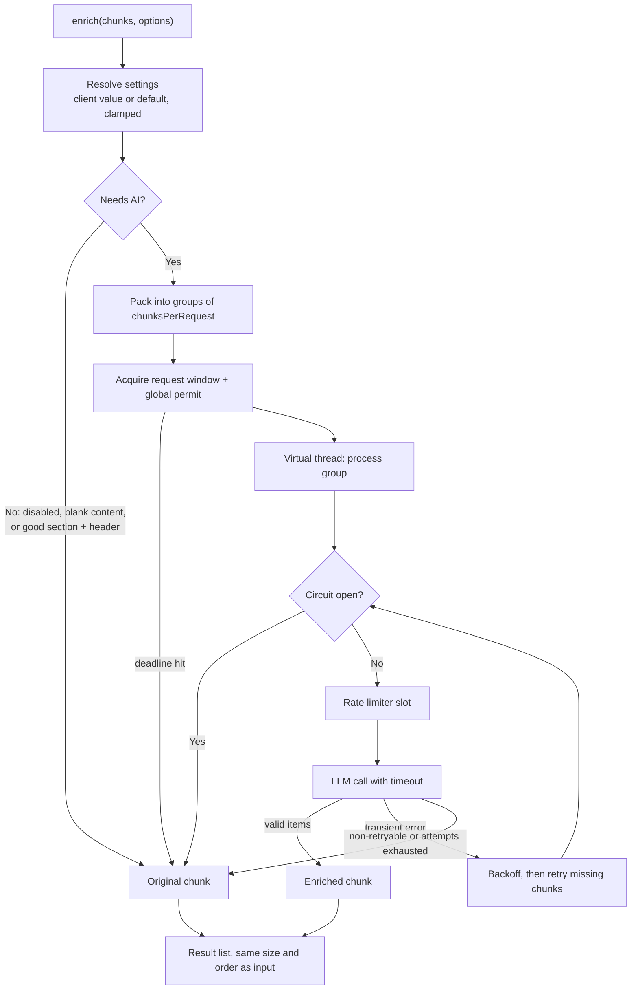

# DocumentEnricher Guide

LLM-based enrichment of chunk **section** and **header** metadata, built to handle thousands of chunks without overloading your system or the LLM API. If the AI fails for any reason, the original chunk is returned.

**Files**

| File | Purpose |
|---|---|
| `DocumentEnricher.java` | The enricher (batching, limits, retry, breaker, fallback) |
| `EnrichmentProperties.java` | Server defaults and hard limits (`application.yml`) |
| `EnrichmentOptions.java` | Optional per-request overrides sent by the client |

---

## 1. Quick start

### Requirements
- Java 21+ (virtual threads), Spring Boot 3.x, Spring AI (with the retry module), Lombok

### 1.1 Enable properties

```java
@SpringBootApplication
@EnableConfigurationProperties(EnrichmentProperties.class)   // or @ConfigurationPropertiesScan
public class DocMindApplication { ... }
```

### 1.2 Executor bean (must be virtual-thread based)

```java
@Bean(name = "enrichExecutor")
ExecutorService enrichExecutor() {
    return Executors.newVirtualThreadPerTaskExecutor();
}
```

Concurrency is controlled by the enricher's semaphores, not by the pool size. Do not use a small fixed thread pool: the per-call timeout submits a nested task to the same executor and could starve.

### 1.3 application.yml (everything is optional)

```yaml
docmind:
  enrich:
    # per-request defaults (client can override)
    enabled: true
    chunks-per-request: 5
    max-attempts: 3
    max-content-chars: 800
    skip-if-meaningful: true
    call-timeout-seconds: 30
    total-timeout-seconds: 600
    # global protection (client can NOT override)
    max-concurrency: 8
    requests-per-second: 10
    initial-backoff-ms: 500
    max-backoff-ms: 10000
    breaker-failure-threshold: 5
    breaker-open-seconds: 30

spring:
  ai:
    retry:
      max-attempts: 1     # IMPORTANT: the enricher already retries. Don't stack two retry layers.
```

Also set read and connect timeouts on the HTTP client behind `enrichChatClient` as a second safety net.

---

## 2. Client usage

### 2.1 From Java

```java
// Use server defaults
List<EnrichedChunk> result = documentEnricher.enrich(chunks);

// Per-request overrides (any field may be null = default)
var options = new EnrichmentOptions(
        null,   // enabled
        4,      // maxConcurrency
        10,     // chunksPerRequest
        2,      // maxAttempts
        null,   // maxContentChars
        null,   // skipIfMeaningful
        null,   // callTimeoutSeconds
        null);  // totalTimeoutSeconds
List<EnrichedChunk> result = documentEnricher.enrich(chunks, options);

// null options is fine too
documentEnricher.enrich(chunks, null);
```

### 2.2 From an API client (JSON)

Add an optional `enrichment` object to your existing request DTO:

```java
public record IngestRequest(String fileName, EnrichmentOptions enrichment) {}
```

```json
{
  "fileName": "handbook.pdf",
  "enrichment": {
    "chunksPerRequest": 10,
    "maxAttempts": 2,
    "maxConcurrency": 4
  }
}
```

For multipart uploads, send the options as a JSON part:

```java
@PostMapping(value = "/ingest", consumes = MediaType.MULTIPART_FORM_DATA_VALUE)
public ResponseEntity<?> ingest(@RequestPart("file") MultipartFile file,
                                @RequestPart(value = "options", required = false) EnrichmentOptions options) {
    // ... chunk the file ...
    var enriched = documentEnricher.enrich(chunks, options);   // options may be null
    // ...
}
```

```bash
curl -X POST http://localhost:8080/ingest \
  -F "file=@handbook.pdf" \
  -F 'options={"chunksPerRequest":10,"maxAttempts":2};type=application/json'
```

Omit `enrichment` (or any field) and the server default is used. To turn AI enrichment off for one request: `{"enrichment": {"enabled": false}}`.

### 2.3 Options reference

| Field | Type | Default | Allowed range | Meaning |
|---|---|---|---|---|
| `enabled` | boolean | `true` | | `false` returns the original chunks, with no LLM calls |
| `maxConcurrency` | int | `8` | 1 to server cap | Max in-flight LLM calls for this request. **Can only be lower than the global cap** |
| `chunksPerRequest` | int | `5` | 1 to 20 | Chunks packed into one LLM call. Higher = fewer calls, bigger prompts |
| `maxAttempts` | int | `3` | 1 to 5 | Total attempts per call (`1` = no retry) |
| `maxContentChars` | int | `800` | 100 to 4000 | Content characters sent per chunk (the start is usually enough) |
| `skipIfMeaningful` | boolean | `true` | | Skip the LLM when the existing section and header are already good |
| `callTimeoutSeconds` | int | `30` | 1 to 300 | Timeout for one LLM call |
| `totalTimeoutSeconds` | int | `600` | 10 to 3600 | Deadline for the whole document |

**Rules**
- `null` means server default.
- Out-of-range values are **clamped**, not rejected (for example `chunksPerRequest: 500` becomes `20`).
- Clients cannot change global protections: the concurrency cap, requests per second, backoff and circuit breaker. These protect the shared LLM API.

### 2.4 Presets

| Goal | Options |
|---|---|
| Cheapest and fastest | `{"chunksPerRequest":15,"maxContentChars":400,"maxAttempts":1}` |
| Best quality | `{"chunksPerRequest":3,"maxContentChars":2000,"skipIfMeaningful":false}` |
| Gentle on the provider | `{"maxConcurrency":2}` |
| No AI at all | `{"enabled":false}` |

### 2.5 The call is synchronous

`enrich(...)` blocks until the result is ready (or the deadline passes). For large documents, call it from a background job or async pipeline rather than a request thread.

---

## 3. How it works



### Step by step

1. **Resolve settings.** The client's options are merged with the defaults and clamped.
2. **Decide who needs AI.** A chunk is skipped (original kept, no cost) when:
   - `enabled` is `false`, or
   - its content is blank, or
   - `skipIfMeaningful` is on and both section and header are meaningful. A value counts as meaningful if it has at least 3 characters and is not a placeholder (`untitled`, `unknown`, `n/a`, `na`, `none`, `null`, `undefined`, `section`, `header`, `general`).
3. **Batch.** The remaining chunks are packed `chunksPerRequest` per call. 5,000 chunks at 5 per call is 1,000 calls instead of 5,000.
4. **Sliding window.** Before starting a call, the caller acquires a per-request permit and a global permit. When both are exhausted, submission waits, so memory stays flat and a slow call doesn't block the others.
5. **Process a group** (on a virtual thread):
   1. If the circuit breaker is open, skip the LLM.
   2. Take a slot from the global rate limiter.
   3. Call the LLM with structured output and a hard timeout.
   4. Keep only **valid** items (matching id, non-blank section and header).
   5. If some chunks are missing or invalid, retry **only those** after a backoff.
6. **Assemble.** Every chunk gets an enriched or original result. A final sweep fills any leftover slot, so the output size and order always equal the input.

---

## 4. Protection mechanisms

### 4.1 Concurrency (backpressure)
Two semaphores: one per request (`maxConcurrency`) and one **global** (`docmind.enrich.max-concurrency`) shared by every document processed by this instance. Ten simultaneous uploads still produce at most 8 in-flight LLM calls.

### 4.2 Rate limit
A global limiter spaces LLM calls evenly at `requests-per-second`. It applies to every attempt, including retries. `0` disables it.

### 4.3 Retry
- Only **transient** failures are retried: `TransientAiException`, HTTP 408, 429 and 5xx, timeouts, and IO errors.
- **Non-retryable** errors (for example `NonTransientAiException`, HTTP 4xx) stop immediately and use the original chunk.
- Backoff is exponential with equal jitter: `cap = min(maxBackoff, initial * 2^(attempt-1))`, then `delay = cap/2 + random(0..cap/2)`.
- A `Retry-After` header (seconds) on 429 or 503 is honored, capped at `max-backoff-ms`.
- There is no sleep after the last attempt, and backoff never sleeps past the deadline.

### 4.4 Circuit breaker
Shared across all requests on the instance.

| State | Behavior |
|---|---|
| **Closed** | Normal operation. Counts consecutive transient failures. |
| **Open** | After `breaker-failure-threshold` consecutive failures. LLM calls are skipped and chunks fall back instantly. Lasts `breaker-open-seconds`. |
| **Half-open** | After the cool-down, exactly one probe call is allowed. Success closes the breaker, failure reopens it. |

Only provider-health failures trip it. Deadlines, interrupts, 4xx errors and bad LLM output do not. `breaker-failure-threshold: 0` disables it.

### 4.5 Timeouts
- **Per call:** `callTimeoutSeconds`. On timeout the call is cancelled and interrupted, and it counts as a retryable failure.
- **Per document:** `totalTimeoutSeconds`. Once passed, no new calls start, and remaining chunks use the original metadata. The caller never waits more than the deadline plus 5 seconds.

---

## 5. Fallback guarantees

The result **always** has the same size and order as the input. The original section, header and content are used when:

| Situation | Result |
|---|---|
| AI disabled, blank content, or already meaningful metadata | Original, no call made |
| Retries exhausted | Original |
| Non-retryable error (4xx, and so on) | Original, immediately |
| Circuit breaker open | Original, immediately |
| LLM returns invalid, blank, unknown or duplicate items | Original for those chunks (valid ones are kept) |
| Call timeout | Retried, then original |
| Total deadline reached | Remaining chunks: original |
| Executor rejects the task | Original |
| Thread interrupted | Original for the rest, interrupt flag restored |
| Unexpected exception in a task | Original for that group, other groups unaffected |

AI output is trimmed, and section and header are clipped to 200 characters.

---

## 6. Supported features

| Feature | Supported |
|---|---|
| Thousands of chunks, ordered output | Yes |
| Batching several chunks per LLM call | Yes |
| Per-request configuration with server defaults | Yes |
| Hard global limits that clients can't exceed | Yes |
| Global concurrency cap and rate limit | Yes |
| Circuit breaker with half-open probe | Yes |
| Retry with jitter and `Retry-After` | Yes |
| Partial-response recovery (retry only missing chunks) | Yes |
| Per-call timeout and total deadline | Yes |
| Skip the LLM when metadata is already good | Yes |
| Prompt-injection hardening and template-safe prompts | Yes |
| Document-level metadata (`enrich(Metadata, List<Document>)`) | Yes, unchanged |

**Not included**
- **Caching by content hash** (for example Caffeine), so re-uploads cost zero calls. This is the recommended next step.
- **Cluster-wide limits.** The semaphore, rate limiter and breaker are per JVM instance. With N instances the effective limits are N times higher, so divide `max-concurrency` and `requests-per-second` accordingly.
- **Metrics export.** Only log summaries are produced (see below).

---

## 7. Capacity planning

```
calls        = ceil(pendingChunks / chunksPerRequest)
min duration = max( calls / requestsPerSecond ,  calls * avgLatency / maxConcurrency )
```

Example: 5,000 chunks, 5 per call gives 1,000 calls. With 10 requests per second the rate limit allows 100 s. With 8 concurrent calls at 3 s each, throughput is about 2.7 calls/s, so roughly 375 s. The default 600 s deadline fits. For larger documents raise `totalTimeoutSeconds` or `chunksPerRequest`.

---

## 8. Logging and troubleshooting

Each run logs one summary line:

```
Enrichment done: total=5000, skipped=1200, enriched=3700, fallback=100, llmCalls=780, took=241000ms
```

| Symptom | Likely cause and fix |
|---|---|
| Many 429 errors | Lower `requests-per-second` and `max-concurrency`; check `spring.ai.retry.max-attempts=1` |
| `fallback` count is high | Provider outage (breaker open), timeouts too short, or bad LLM output. Check the warn logs |
| Run hits the deadline | Raise `totalTimeoutSeconds` or `chunksPerRequest`, or lower `maxContentChars` |
| Log "Circuit breaker OPEN" | The provider is failing. It self-heals after `breaker-open-seconds` |
| Nothing is enriched | Chunks probably already have meaningful metadata. Set `skipIfMeaningful: false` |
| Fields ignored after startup | Values are read at startup from `application.yml`; per-request overrides come only through `EnrichmentOptions` |
| Calls hang or time out oddly | Executor is not virtual-thread based, or HTTP client timeouts are missing |

---

## 9. Behavior notes

- `null` or empty chunk list returns `List.of()`.
- A `null` element inside the list throws `IllegalArgumentException`, since there is no original to fall back to.
- Old signature `enrich(chunks, int batchSize)` is replaced by `enrich(chunks)` and `enrich(chunks, options)`.
- `AiChunkMetadata` is no longer used. The batch response uses the nested `AiItem` and `AiBatch` records.
